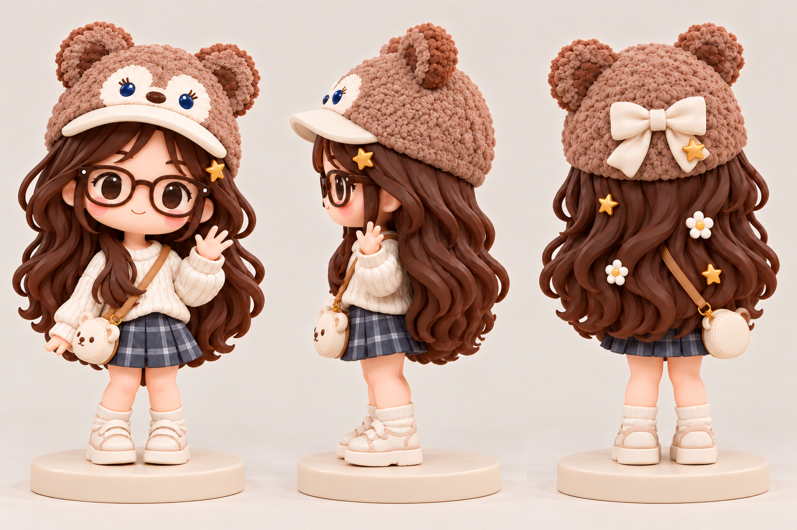

# 小秦 · 小熊帽手办资料库

整理日期：2026-10-27。当前收录模型为 **v38：后背粗发束收细（2026-10-26）**。

## 资料导航

| 目录 | 内容 |
| --- | --- |
| `design/` | 建模交接说明、三视外观参考、v1–v5 效果图 |
| `design/details/` | 原始局部细节参考图集 |
| `model/v38/` | 可编辑 Blender 文件、GLB、自动加载预览及对照图、原始校验记录 |
| `scripts/history/` | 历史建模、打包与检查脚本；多数使用原机器绝对路径，运行前需调整 |
| `docs/version-index.json` | 原始各版本目录及顶层模型/校验文件索引 |
| `docs/source-manifest.json` | 收录文件来源、字节数和 SHA-256 |
| `docs/package-verification.json` | 本次整理的完整性与预览数据校验结果 |

## 查看和编辑

克隆或下载整个仓库后，打开 `model/v38/粗发束收细对照.html` 查看前后对照；打开同目录 `小秦_可旋转三维重建.html` 查看可旋转模型。必须保留 `自动加载数据_6b52891b3f9e/` 分块文件夹。预览按原实现自动载入模型；GitHub 文件页只展示源码，不直接运行三维页面。

使用 Blender 打开 `model/v38/小秦_v38后背粗发束收细.blend` 编辑，也可将同名 GLB 导入三维软件。大文件使用普通 Git 保存，初次克隆需要下载完整模型与预览数据。

## 设计与验收状态

目标为含底座约 120 mm 的树脂手办，人物约 114 mm、底座约 6 mm，均为设计目标，需打样确认。具体人物造型、左右方向、斜挎包位置及分件建议见 `design/小秦_手办建模交接说明_v1.md`。该说明保留早期设计阶段措辞，当前已存在三维网格。

v38 基于 v36 对既有后发束做横向收细，替代 v37 的表面刻槽方案。原始校验报告记载：非头发几何、接触修复区域及材质纹理保留，反向三角形诊断为 0；同时继承了 308 条边界边和 308 条非流形边，`inherited_v36_production_acceptance` 为 false。因此当前归档不代表已经通过闭合性、壁厚、拆件装配或实体打印验收。

原始浏览器校验记录报告自动导入成功、无文件选择器、解压模型 SHA 与 GLB 一致，页面与控制台无错误；这是原有记录，本次另行核验文件与分块数据的一致性。

## 版本与归档范围

桌面原 `小秦_最新三维预览.html` 实际仍指向 v33；本仓库直接提供 v38 入口，未使用该旧入口。历史源模型、过程备份、旧自动加载分块保留在原目录，本次以版本索引记录，避免与 v38 混用。v35 从零重建方案与 v34/v35 计划是历史方案，不表示已按方案完成。

未收录相册、宠物动画、Python 运行环境及第三方依赖缓存。原始文件保持不动；归档预览仅补齐了帽子参考图片依赖。本仓库未新增开放源代码或素材授权，第三方资源沿用各自权利归属。

## 使用的 Skills

以下记录本次资料整理、校验与 GitHub 上传过程中实际读取和参考的 Codex Skills：

| Skill | 本次用途 |
| --- | --- |
| `using-superpowers` | 检查适用技能，组织资料整理与上传流程。 |
| `verification-before-completion` | 在完成前核验文件 SHA-256、Git 提交中的文件内容、预览链接及模型分块解压结果，并确认远程与本地提交一致。 |
| `web-access` | 参考联网操作与工具选择说明；本次 GitHub 操作实际通过 Git 和 GitHub CLI（`gh`）完成。 |

Skills 是指导工作流程的指令集。实际归档与校验还使用了 Python，模型编辑与历史脚本涉及 Blender；这些工具不属于 Skill。本仓库不依赖安装上述 Skills 才能查看资料或打开模型。

本清单仅覆盖本次归档上传过程。早期二维形象生成和各版三维建模所用的 Skills，现有资料未提供完整记录，因此未作推定。
